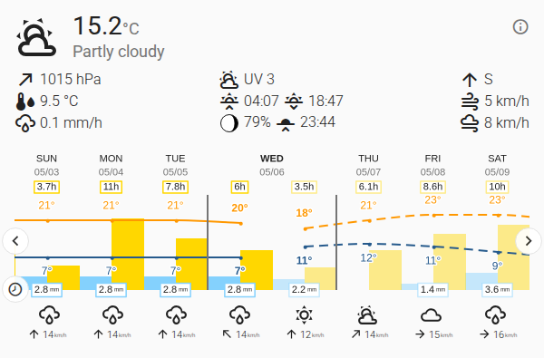
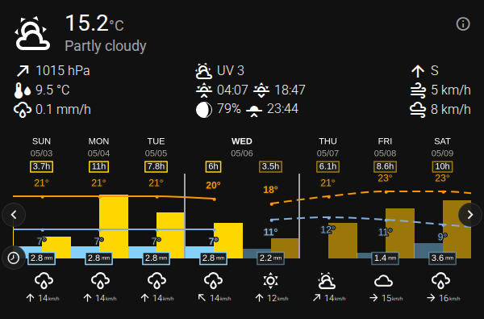
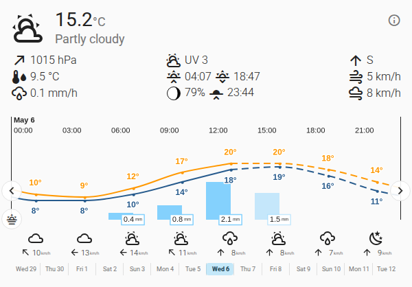
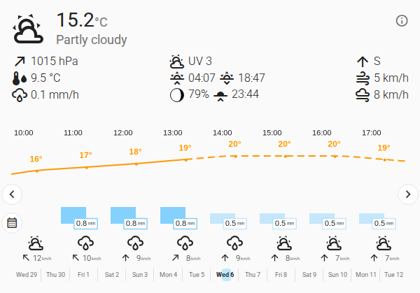
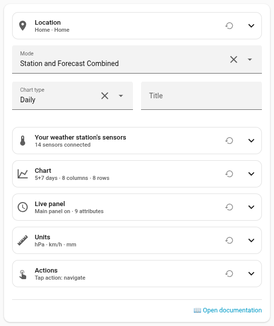
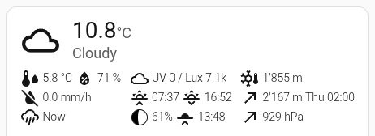
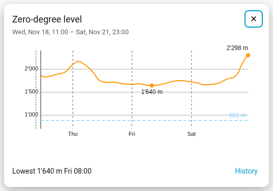

<p align="center">
  
</p>

<h1 align="center">Weather Station Card</h1>

<p align="center"><em>Weather station meets forecast.</em></p>

<p align="center">
  <a href="LICENSE.md"></a>
  <a href="https://hacs.xyz/"></a>
  <a href="https://github.com/chriguschneider/weather-station-card/releases/latest"></a>
  <a href="https://github.com/chriguschneider/weather-station-card/actions/workflows/build.yml"></a>
  <a href="https://sonarcloud.io/summary/new_code?id=chriguschneider_weather-station-card"></a>
  <a href="https://github.com/chriguschneider/weather-station-card/releases"></a>
  <a href="https://github.com/chriguschneider/weather-station-card/stargazers"></a>
  <a href="https://github.com/chriguschneider/weather-station-card/commits/master"></a>
  <a href="#the-editor"></a>
  <a href="https://buymeacoffee.com/chriguschneider"></a>
  <a href="#ai-assisted-development"></a>
</p>

<p align="center">
  <a href="https://my.home-assistant.io/redirect/hacs_repository/?owner=chriguschneider&category=frontend&repository=weather-station-card"></a>
  &nbsp;·&nbsp;
  <a href="https://github.com/chriguschneider/weather-station-card/issues">Issues</a>
  &nbsp;·&nbsp;
  <a href="https://github.com/chriguschneider/weather-station-card/discussions">Discussions</a>
  &nbsp;·&nbsp;
  <a href="ARCHITECTURE.md">Architecture</a>
  &nbsp;·&nbsp;
  <a href="CONTRIBUTING.md">Contributing</a>
  &nbsp;·&nbsp;
  <a href="CHANGELOG.md">Changelog</a>
</p>

A dashboard card for Home Assistant that draws what your own weather station
measured next to what the forecast says, in one chart.

<table>
<tr>
<td></td>
<td></td>
</tr>
</table>

## What it does

- **Past and forecast in one chart.** Your station's history on the left,
  any `weather.*` forecast on the right, today in the middle. Measured
  values are solid, predicted ones dashed.
- **A live panel from your sensors.** Temperature, dew point, pressure with
  its trend, wind, rain rate, UV, sun and moon. Tap a value for its history;
  the ⓘ button tells where each value comes from.
- **Weather symbols from measurements.** Sunny, cloudy, rainy, fog, windy:
  derived from your sensors, not taken from a forecast
  ([how](docs/CONDITIONS.md)).
- **Any station.** The card reads plain `sensor.*` entities (Ecowitt,
  Tempest, Netatmo, Davis, ESPHome, …), in whatever unit they report.
- **Any place.** A card can show another location, in that place's own
  time ([configuration](docs/CONFIGURATION.md#general)).
- **No YAML needed.** A visual editor, translated into 25 languages.

## Three views

<table>
<tr>
<th>Daily</th>
<th>Today</th>
<th>Hourly</th>
</tr>
<tr>
<td></td>
<td></td>
<td></td>
</tr>
</table>

A button in the chart switches between them. Each view works with station
and forecast together, station only or forecast only:
[all nine combinations](docs/MODES.md).

## The editor



Everything is set in the card's editor; each panel's header shows what is
set, so you rarely have to open one. Every YAML key is listed in
[docs/CONFIGURATION.md](docs/CONFIGURATION.md).

## Works together

Three independent installs, none needs the others: this card,
[MeteoSwiss Weather](https://github.com/chriguschneider/hass-meteoswiss-weather)
(weather entity and sensors from official Swiss open data) and
[MeteoSwiss Radar](https://github.com/chriguschneider/hass-meteoswiss-radar)
(radar animation and a next-rain sensor). Each link between them is an
ordinary Home Assistant entity, so any other source works in the same slots.



| What you get | From | More |
| --- | --- | --- |
| **Next rain**: "in 12 min", "17:00" or "No rain" | the radar's next-rain sensor | [docs/NEXT-RAIN.md](docs/NEXT-RAIN.md) |
| **Snow line** now and its trend over 48 h, with a forecast curve on tap | the weather integration's zero-degree sensors | [docs/SNOW-LINE.md](docs/SNOW-LINE.md) |
| **Sunshine today** | the weather integration's sunshine sensor | [docs/SENSORS.md](docs/SENSORS.md) |



## Get started

[](https://my.home-assistant.io/redirect/hacs_repository/?owner=chriguschneider&category=frontend&repository=weather-station-card)

In Home Assistant open **Settings → Marketplace** (HACS on versions before
2026.11), search for **Weather Station Card**, install it and reload the
browser. Then add the card to a dashboard; the editor picks your most likely
sensors. In YAML the smallest card is:

```yaml
type: custom:weather-station-card
weather_entity: weather.home
sensors:
  temperature: sensor.outdoor_temperature
```

Betas, manual install and what to do after an update:
[docs/INSTALLATION.md](docs/INSTALLATION.md).

## Documentation

| | |
| --- | --- |
| [Installation](docs/INSTALLATION.md) | Marketplace, HACS, by hand, betas |
| [Configuration](docs/CONFIGURATION.md) | every option, with examples |
| [Modes](docs/MODES.md) | the nine combinations of blocks and views |
| [Sensors](docs/SENSORS.md) | rain, sunshine and which sensor goes where |
| [Conditions](docs/CONDITIONS.md) | how the weather symbol is worked out |
| [Next rain](docs/NEXT-RAIN.md) · [Snow line](docs/SNOW-LINE.md) | the rows fed by the MeteoSwiss integrations |
| [Troubleshooting](docs/TROUBLESHOOTING.md) | error banners and common gotchas |
| [Changelog](CHANGELOG.md) · [Migration](MIGRATION.md) | what changed, and what to do when upgrading |

## Community

Questions and ideas go to [Discussions](https://github.com/chriguschneider/weather-station-card/discussions),
bugs to [Issues](https://github.com/chriguschneider/weather-station-card/issues/new/choose).
Pull requests are welcome, and a translation fix is a good first one:
[CONTRIBUTING.md](CONTRIBUTING.md), [ARCHITECTURE.md](ARCHITECTURE.md).

<a href="https://github.com/chriguschneider/weather-station-card/graphs/contributors">
  
</a>

## AI-assisted development

This card is built by Chrigu & Claude, a human and an LLM working together.
What the card should do, its architecture and the meteorology behind the
symbols are mine; a large share of the typing, tests and refactors was done
by [Claude Code](https://claude.com/claude-code). Every change is reviewed
and tested before it ships. If the card has earned a spot on your dashboard,
[buying me a coffee](https://buymeacoffee.com/chriguschneider) is the nicest
way to say thanks ❤️ *(Claude doesn't drink coffee. More for me.)*

## Attribution & licence

A fork of [`mlamberts78/weather-chart-card`](https://github.com/mlamberts78/weather-chart-card)
(upstream v1.0.1, October 2024). MIT licence, same as upstream:
[LICENSE.md](LICENSE.md).
