# Modes and chart resolutions

Which blocks the card draws (station, forecast or both) and at which resolution (daily, today, hourly), with a picture of every combination.

→ Back to [README](../README.md)

The card has two independent axes: which **blocks** render
(combination / station / forecast) and which time **resolution**
the chart uses (daily / today / hourly). All nine combinations are
supported; you cycle resolutions live with the chart's mode-toggle
button.

<table>
<tr>
<th></th>
<th>Daily (default)</th>
<th>Today (day pager)</th>
<th>Hourly (7 days)</th>
</tr>
<tr>
<th>Combination</th>
<td>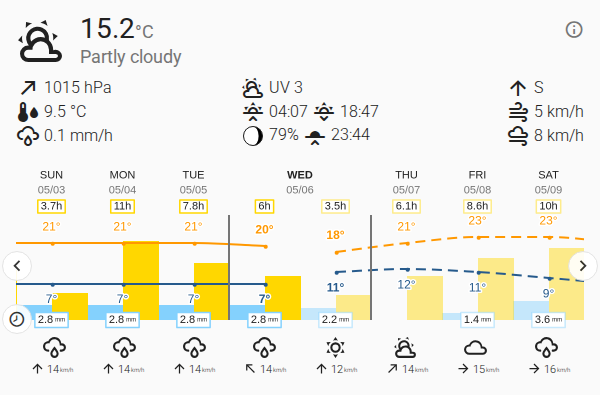</td>
<td>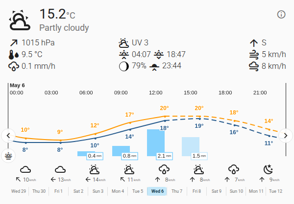</td>
<td>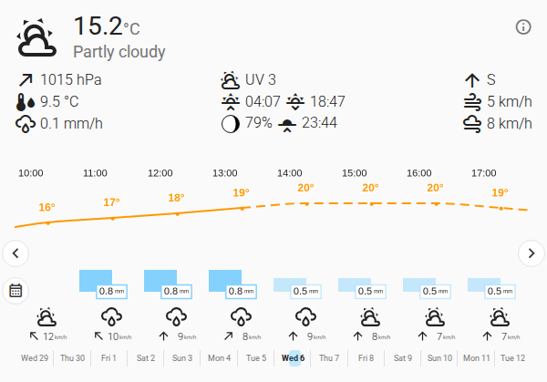</td>
</tr>
<tr>
<th>Station</th>
<td>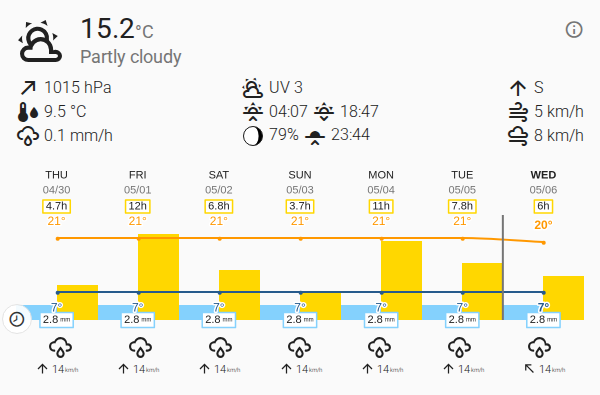</td>
<td>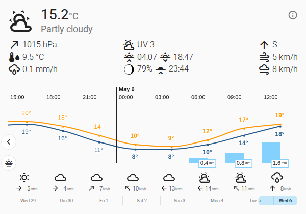</td>
<td>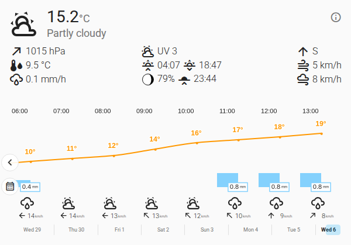</td>
</tr>
<tr>
<th>Forecast</th>
<td>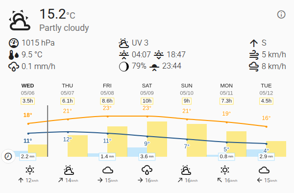</td>
<td>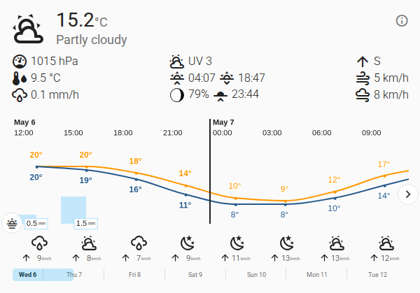</td>
<td>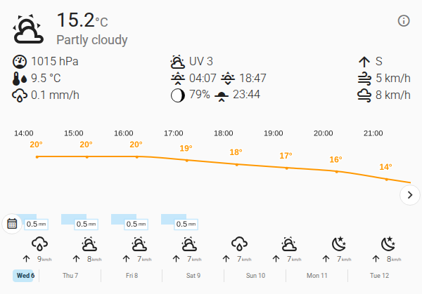</td>
</tr>
</table>

<!-- Dark-theme matrix as a collapsible block. Deliberately NOT the
     <picture>/prefers-color-scheme mechanism: the HACS info-panel
     sanitizer drops <picture>/<source> (see the README-image rule in
     the repo conventions), while 
 with plain  children
     survives both GitHub and HACS. -->

🌙 <b>Same matrix in a dark theme</b> (click to expand)

<table>
<tr>
<th></th>
<th>Daily (default)</th>
<th>Today (day pager)</th>
<th>Hourly (7 days)</th>
</tr>
<tr>
<th>Combination</th>
<td>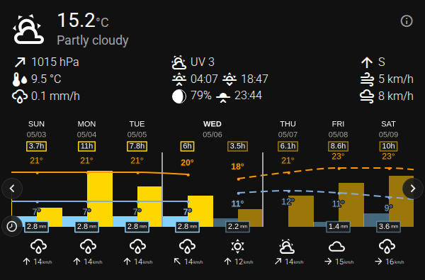</td>
<td>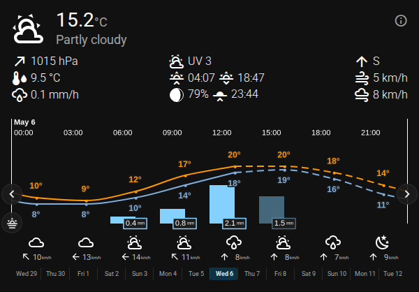</td>
<td>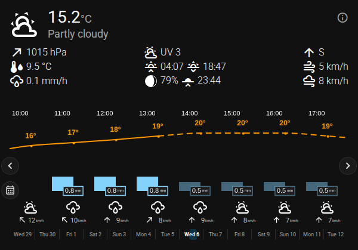</td>
</tr>
<tr>
<th>Station</th>
<td>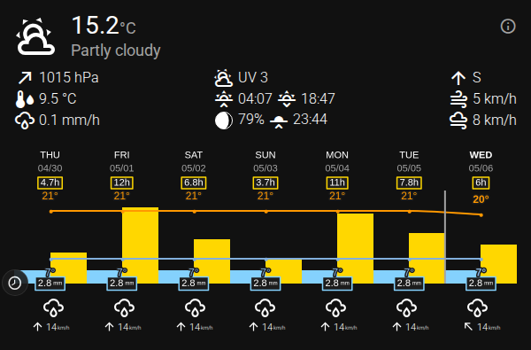</td>
<td>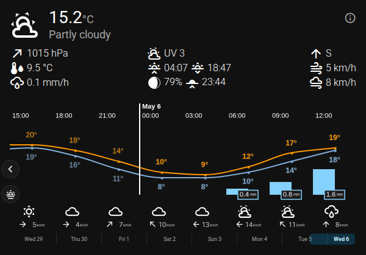</td>
<td>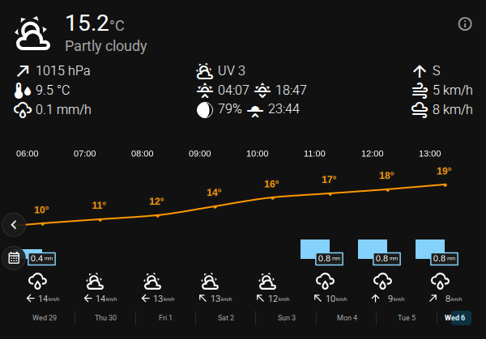</td>
</tr>
<tr>
<th>Forecast</th>
<td>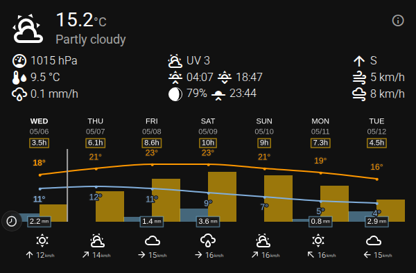</td>
<td>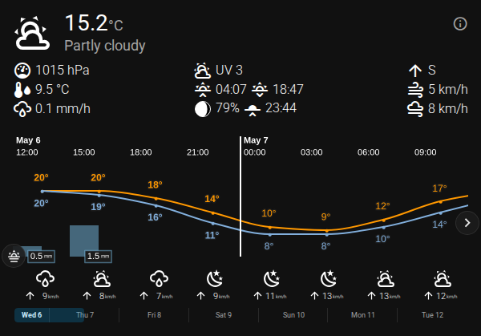</td>
<td>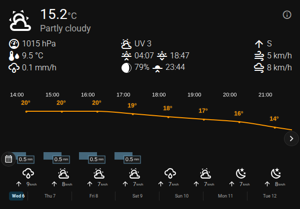</td>
</tr>
</table>

**Modes** (rows):

- **Combination** — past sensor history + today as a doubled column
  (measured + predicted) + forecast from a `weather.*` entity. Forecast
  temperature lines are dashed and forecast precipitation bars draw at
  ~45 % opacity so predicted values read distinctly from measured ones.
- **Station** — past sensor history only, no forecast block. No
  `weather.*` entity needed.
- **Forecast** — forecast-only, no station-history block. Useful when
  another sensor-history visualisation lives elsewhere on the
  dashboard.

**Chart resolutions** (columns):

- **Daily** (default) — one column per day across the past + forecast
  window. The classic view.
- **Today** — a day pager: the viewport frames exactly one calendar
  day as 8 × 3-hour blocks and pages day-wise through the whole
  `days:` window. Chevrons step one day at a time, free scrolling
  snaps to day boundaries, and the view opens on the current day
  (measured hours solid, forecast hours dashed).
- **Hourly** — one column per hour over 7 days, scrollable. 168
  columns; the jump-to-now button snaps the viewport to the present
  hour, and a slim day timeline below the chart shows where you are
  (click or scrub it to navigate).
